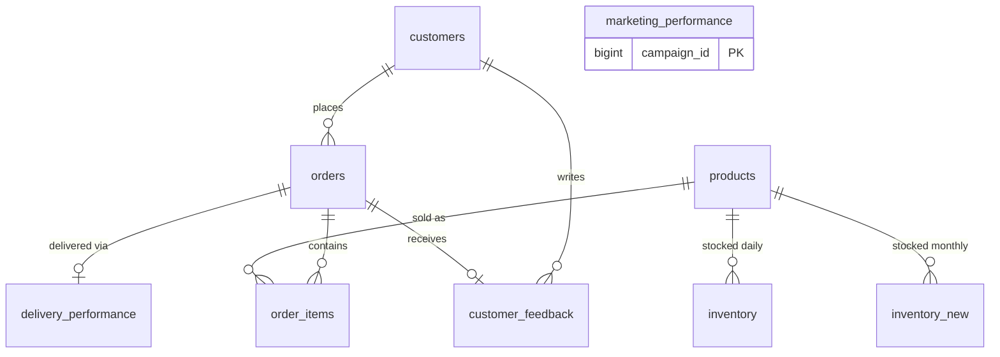

# Blinkit Data Cleaning in SQL Server (Bronze → Silver)

A hands-on SQL learning project: loading nine raw Blinkit (quick-commerce) CSV files into SQL Server, profiling every table, cleaning and typing the data, and validating the result so it is ready for analysis in Power BI or Tableau.

> **Status:** learning project. The focus is on doing the cleaning step by step, understanding *why* each decision was made, and documenting the data-quality findings honestly.

---

## What this project covers

- Loading raw CSVs into SQL Server with `BULK INSERT`
- A two-layer design: **bronze** (raw, everything as text) and **silver** (cleaned, typed, constrained)
- Profiling each table before changing anything
- Cleaning: trimming text, fixing line breaks, converting dates and numbers safely, handling blanks vs `NULL`, removing exact duplicates
- Enforcing integrity with primary keys, foreign keys and `CHECK` constraints
- Validating every load with row counts, anti-joins and control totals

## Tech stack

- Microsoft SQL Server (2017 or newer, because of `BULK INSERT ... FORMAT = 'CSV'` and `TRIM`)
- SQL Server Management Studio (SSMS)
- T-SQL

## Architecture

```
CSV files  ──BULK INSERT──▶  bronze (raw text)  ──clean + type + validate──▶  silver (analysis-ready)
```

| Layer | Purpose |
|---|---|
| `bronze` | Exact copy of the source files. Every column is `VARCHAR`, so a load never fails on a bad value. Never modified after loading. |
| `silver` | Cleaned tables with proper data types, keys and constraints. This is what dashboards connect to. |

### Table relationships (silver)



`marketing_performance` is standalone: it has no customer or order key, so it can only be linked to other tables by date.

## Dataset

Nine CSV files. The data appears to be synthetic (for example, onions priced near 950), so numbers should not be read as real business results.

| Source file | Silver table | Rows | Grain |
|---|---|---|---|
| `blinkit_customers.csv` | `silver.customers` | 2,500 | one row per customer |
| `blinkit_products.csv` | `silver.products` | 268 | one row per product |
| `blinkit_orders.csv` | `silver.orders` | 5,000 | one row per order |
| `blinkit_order_items.csv` | `silver.order_items` | 5,000 | one row per (order, product) |
| `blinkit_delivery_performance.csv` | `silver.delivery_performance` | 5,000 | one row per order |
| `blinkit_customer_feedback.csv` | `silver.customer_feedback` | 5,000 | one row per feedback |
| `blinkit_inventory.csv` | `silver.inventory` | 75,172 | one row per (product, day) |
| `blinkit_inventoryNew.csv` | `silver.inventory_new` | 10,746 (from 18,105) | stock records by product and month |
| `blinkit_marketing_performance.csv` | `silver.marketing_performance` | 5,400 | one row per campaign run |

## Method: profile → decide → transform → validate

For every table the same four steps were followed:

1. **Profile:** look for duplicates, blanks, hidden spaces, values that will not convert, impossible values and broken relationships. Nothing is changed in this step.
2. **Decide:** fix, delete or flag, using one rule: **fix** only what is provably wrong and the correct value is known, **delete** only exact duplicates or invalid records, **keep and flag** anything that merely looks odd.
3. **Transform:** write the cleaned, typed data into `silver`.
4. **Validate:** prove nothing was lost or altered.

## What was cleaned, table by table

| Table | Main cleaning and checks |
|---|---|
| `customers` | Trimmed trailing spaces in 6 `area` values; replaced line breaks inside 1,894 addresses with `, `; lowercased emails; kept 4 emails shared by two different customers (different `customer_id`s, so not duplicates). |
| `products` | Clean source. Added type conversion plus `CHECK` rules (price ≤ MRP, min stock < max stock). Verified `margin_percentage` matches `(mrp − price) / mrp` on every row. |
| `orders` | Converted text to `DATETIME2`; checked no delivery is promised or made before the order; verified `delivery_status` matches actual minutes late; foreign key to customers. |
| `order_items` | Composite primary key `(order_id, product_id)`; computed column `line_total`; verified every `unit_price` equals the catalog price. |
| `delivery_performance` | Converted blank reasons to real `NULL` (1,902 rows) with `NULLIF`; confirmed `delivery_time_minutes` is *actual minus promised* (negative = early). |
| `customer_feedback` | Type conversion; `CHECK` constraints on rating (1 to 5) and sentiment; verified links to orders and customers. |
| `inventory` | Converted `dd-mm-yyyy` text using explicit style `105` (29,399 dates were ambiguous between day-first and month-first); renamed `date` to `inventory_date`. |
| `inventory_new` | Converted month labels like `Mar-23` to a real date (style `106`); removed 7,359 exact duplicate rows with `ROW_NUMBER()`; added a surrogate `IDENTITY` key. |
| `marketing_performance` | Kept the stored ROAS as `roas_reported` and added a computed `roas_calculated` (revenue ÷ spend); funnel checks (clicks ≤ impressions, conversions ≤ clicks). |

## Data-quality notes (found but deliberately not "fixed")

Cleaning means fixing what is provably wrong, not guessing. These were flagged instead:

1. **`order_total` does not reconcile with order items.** Only 1 of 5,000 orders has `order_total` equal to quantity × unit price. Revenue analysis should pick one definition and stick to it; this project uses `line_total` from `order_items`.
2. **1,568 on-time deliveries have a "Traffic" delay reason.** It is the only reason in the data. Delay-reason analysis should be limited to delayed orders.
3. **Customer feedback sentiment overlaps ratings.** Rating 3 appears as both Negative and Neutral, and rating 4 as both Neutral and Positive, so sentiment is not purely rating-based. Feedback category also does not reliably match the comment text, and there are only 25 distinct comments.
4. **29,255 daily inventory rows (about 39%) have more damaged units than received units.** Damaged stock may come from stock already on the shelf, so this was kept.
5. **`inventory_new` is not unique by (product, month).** After removing exact duplicates, 4,040 product-month combinations still have several rows, and some "duplicates" could be genuine repeat receipts. It also does not reconcile with the daily `inventory` table (147,526 units received there vs 28,779 here). Use `inventory` for stock analysis.
6. **Stored ROAS is wrong on 5,374 of 5,400 rows.** Use `roas_calculated`, and for an overall figure use `SUM(revenue) / SUM(spend)` rather than an average of ratios.
7. **Repeated facts across tables.** `delivery_performance` repeats columns already in `orders`, and `customer_feedback.customer_id` repeats the order's customer. `delivery_partner_id` and `store_id` are unique on every order, so they are not useful for grouping.
8. **328 of 2,500 customers never placed an order.** A business fact, not an error.

## Loading gotchas worth remembering

- The CSV files use **Windows line endings (`\r\n`)**. Forcing `ROWTERMINATOR = '0x0a'` leaves a hidden `\r` on the last column of every row, and numeric conversion fails on exactly that column. The fix is to leave `ROWTERMINATOR` out so the default `\r\n` applies.
- `FORMAT = 'CSV'` with `FIELDQUOTE = '"'` is what lets SQL Server handle quoted fields that contain line breaks.
- `BULK INSERT` reads files from the **server's** file system, not from your laptop.
- Always state date formats explicitly (`TRY_CONVERT(DATE, text, 105)`) instead of relying on server language settings.

## Validation approach

Every silver load was checked with:

- **Row counts:** silver rows equal bronze rows (minus intentionally removed duplicates)
- **Anti-join:** `LEFT JOIN ... WHERE right.key IS NULL` to prove no bronze row went missing
- **Control totals:** sums of key numeric columns match between bronze and silver
- **Constraints:** primary keys, foreign keys and `CHECK` rules reject future bad data

## SQL concepts practised

`BULK INSERT` · `TRY_CAST` / `TRY_CONVERT` · `TRIM` / `REPLACE` · `NULLIF` / `ISNULL` · `CASE` inside `SUM` for profiling · `GROUP BY` / `HAVING` · `INNER JOIN` vs `LEFT JOIN` and anti-joins · subqueries and CTEs · `DATEDIFF` · window functions (`ROW_NUMBER() OVER (PARTITION BY ...)`) · primary, composite and surrogate keys · foreign keys · `CHECK` constraints · computed columns · integer division pitfalls (`AVG` on integers)

## How to run

1. Create the database and the `bronze` and `silver` schemas.
2. Create the nine bronze tables (all columns `VARCHAR`).
3. Edit the file paths and run the `BULK INSERT` statements. Confirm the bronze row counts.
4. For each table in dependency order (customers, products, orders, order_items, delivery_performance, customer_feedback, inventory, inventory_new, marketing_performance): run the profiling queries, create the silver table, load it, and run the validation queries.

Suggested repository layout:

```
blinkit-sql-cleaning/
├── README.md
├── data/                  # raw CSVs (or a link to the source)
└── sql/
    ├── 01_database_schemas_bronze.sql
    ├── 02_load_bronze.sql
    ├── 03_silver_customers.sql
    ├── 04_silver_products.sql
    ├── 05_silver_orders.sql
    ├── 06_silver_order_items.sql
    ├── 07_silver_delivery_performance.sql
    ├── 08_silver_customer_feedback.sql
    ├── 09_silver_inventory.sql
    ├── 10_silver_inventory_new.sql
    └── 11_silver_marketing_performance.sql
```

## Next steps

- Connect Power BI or Tableau to the `silver` schema and build dashboards (sales, delivery performance, feedback, inventory, marketing).
- Add views that join the silver tables for reporting.
- Add a final audit script that checks every silver table in one run.

## Author

**Okerio Davis** · Nairobi, Kenya
LinkedIn: [linkedin.com/in/okeriodavis](https://linkedin.com/in/okeriodavis)

*Dataset source: add the link and licence here.*
